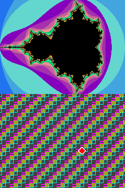

# dsnative

Nintendo DS games, recompiled ahead of time into native code, aimed at iPhone, iPad, Mac and
Apple TV.

dsnative is not an emulator in the usual sense. A DS game's ARM9 and ARM7 machine code is
translated **once, at build time**, into C. That C is compiled for the target like any other
source and linked with a runtime that stands in for the DS hardware. Nothing is generated while
the game runs, so it works where apps can't JIT (iOS, iPadOS and tvOS without a debugger
attached).

This is a proof of concept. It runs homebrew from start to finish. A commercial game (Pokémon
Black 2) now runs through boot on both CPUs, plays its intro movie with sound, shows its textured 3D
title scene and its main menu with the saved game, loads the save into the overworld and opens the
party screen: see [Status](#status) and [the roadmap](docs/design.md#roadmap). The other Pokémon
games (Black, White, White 2, HeartGold, SoulSilver) get as far as their title scenes or first
screens and the beginning of a new game before they reach code they decrypt in RAM, which the
interpreter fallback runs.

Nothing from any game is in this repository. You bring your own dumps.

## Why recompile instead of emulate

The DS's CPUs are 32-bit ARM (ARMv5TE and ARMv4T). Apple silicon can't run 32-bit ARM code at
all, so the Switch projects' approach (patch the game's 64-bit code and run it directly)
doesn't apply here. The code has to be translated, and doing it ahead of time keeps the
advantages of native execution:

- no JIT, so it runs on iOS and tvOS at full speed;
- game code compiled by Clang with full optimization;
- one game, one app, and room for per-game fixes and enhancements later.

## Status

| Part | State |
|---|---|
| ROM reader: header, ARM9/ARM7, Nitro SDK module parameters (SDK 4 to 5, including the ARM7 parameters without a signature), BLZ, autoloads on both CPUs, overlays, file system | done |
| Recompiler: ARMv5TE and ARMv4T, ARM and Thumb, to C | done; matches Unicorn's ARM946 on about 45,000 random snippets |
| Code discovery: calls, branches, jump targets read by a symbolic evaluator (GCC and CodeWarrior switches, ARM and Thumb), interworking veneers, function pointers in literal pools and data, start-up stubs, position-independent stubs found by content | done for the forms seen so far, plus a missing-code feedback loop |
| Overlays sharing an address | handled: each candidate is checked against memory at run time |
| Runtime: dispatcher, CPU modes and banked registers, interrupts, BIOS (high-level: every documented NDS call except GetBootProcs and the DSi-only ones, callback decompression included), CP15, TCM | done |
| Interpreter fallback (`runtime/interp.c`) for code the recompiler cannot have compiled: code modified at run time, stored encrypted, or missed by discovery; no generated code, so it is allowed on iOS and tvOS | done |
| DS hardware: memory map, VRAM banks, DMA, timers, IPC sync and FIFOs, divider, square root, cartridge reads, SPI (power, firmware, touch), keypad | done for what homebrew uses |
| 2D engines: text, affine, extended affine and bitmap backgrounds (including the large bitmap and extended palettes), regular, affine and bitmap sprites, windows, mosaic, blending, master brightness, VRAM and main memory display, internal affine reference points, the 3D layer as BG0; display capture | done |
| Firmware flash (ARM7 SPI): header, Wi-Fi settings, never-configured access point slots (the SDK's start-up check passes), user settings, the chip's full instruction set | done |
| Wi-Fi (ARM7) | a stub: the SDK's initialization runs (ports, baseband and RF chips, Wi-Fi RAM) and reports no network; nothing is received or sent |
| DSi registers in DS mode | SCFG, MBK and the new blocks read 0 and drop writes; SNDEXCNT and GPIO on the ARM7 work, as a DSi running a DS cartridge has them |
| RTC (ARM7): serial protocol, status, date and time (BCD, 12/24-hour), alarms, frequency, adjust and free registers, reset, /INT through RCNT; starts at host time or `--rtc`, runs on emulated time | done |
| Save memory: EEPROM, FLASH and FRAM on the cartridge SPI bus, save file on disk; the chip comes from `--save-type`, a game-code table, a save file's size, else FLASH 512 KB with a note on stderr | done |
| Sound: 16 channels (PCM8, PCM16, IMA-ADPCM, PSG, noise), capture, mixer at 32768 Hz into a ring for the app, ARM7 BIOS sound calls | done; Pokémon Black 2's sound driver runs |
| 3D engine: geometry engine (command FIFO and ports, GXSTAT, matrix stacks, lighting, clipping, box/position/vector tests, geometry FIFO DMA) and a software rasterizer (Z or W buffer, Gouraud, all seven texture formats, modulation/decal/toon/highlight/shadow polygons, alpha blending, fog, edge marking, an approximate anti-aliasing) feeding engine A's BG0 | done (no texture filtering, no exact anti-aliasing; the rasterizer is software) |
| Other games | Pokémon Black, White, White 2, HeartGold and SoulSilver recompile, build and run headless: titles, a new game's first dialogue and name entry (HeartGold and SoulSilver need a touch on the first screens). Each reaches overlay code that is decrypted at run time, which the interpreter fallback runs | boot and the first minutes |
| Speed | `tools/bench.py` measures frames per second and where the time goes (sampling profiler, dispatcher counters, a CPU benchmark in the test ROM, hashes of screens, memory, registers and audio that must not change); the 2D renderer, the 3D rasterizer (screen bands on worker threads) and the dispatcher are tuned: Pokémon Black 2 runs its intro, 3D title scene and main menu at 14-15x real time on an Apple M6 (9-11x on one render thread), the rest of the boot at 36-50x | done for what Black 2 reaches; the generated code is unchanged (a fully busy ARM9 is already 29x real time or better) |
| Apple app shell: Swift package with Metal screens, controllers, touch and pad, audio, saves; macOS, iOS/iPadOS and tvOS apps build from a ROM with `tools/build_app.py` and run in the simulators | done for the homebrew test ROM (no commercial game built into it yet; nothing run on a physical device) |

## Try it

You need Python 3.10 or later with `capstone` 5, a C compiler and, for the tests,
`arm-none-eabi-gcc` and `unicorn`:

```
pip install "capstone>=5,<6" unicorn      # Homebrew's Python wants a venv for this (PEP 668)
sudo apt install gcc-arm-none-eabi         # or: brew install --cask gcc-arm-embedded

python3 tests/difftest.py                  # the recompiler against Unicorn's ARM946
python3 tests/test_discovery.py            # code discovery on small synthetic images
python3 tests/test_rom.py                  # the ROM reader on synthetic images
python3 tests/test_hw.py                   # build a homebrew ROM, recompile it, run it
python3 tests/test_app.py                  # the Mac app on the test ROM (needs Xcode or its Command Line Tools)
```

`test_hw.py` builds a test ROM shaped like a commercial game: a BLZ-compressed ARM9 binary,
Nitro module parameters, an ITCM autoload segment and a file system. It recompiles both CPUs,
runs the result headless for 100 frames and checks the following:

- a CPU workload (CRC, sorting, recursion, jump tables, function pointers, 64-bit division,
  soft-float), compared line by line with the same code compiled for the host;
- the hardware divider and square root against software, and BIOS calls;
- cartridge reads through the card protocol;
- IPC messages to the ARM7, which sleeps in the BIOS between messages;
- VBlank and timer interrupts at the right rates;
- scripted d-pad input moving a sprite.

Both screens are written to `build/hwtest/screen.png`:



### With your own game

```
python3 tools/ndsinfo.py game.nds --code     # what the ROM holds and how much code is found
python3 -m recomp game.nds -o build/game --build
cd build/game && ./dsn_headless ../../game.nds arm9.bin --frames 600 --png out.png --stats
```

`ndsinfo` works on any DS ROM today. The recompiler and build run, and a commercial game runs
until the first hardware the runtime doesn't handle yet. Code discovery missed, or that the game
rewrites at run time, runs in the interpreter fallback, and the runtime appends each such address to
`missing.txt`; pass that file back with `--extra missing.txt` for the next build (it does not help
for code the game stores encrypted: the ROM still holds the ciphertext). `--no-interp` stops at such
code instead, for discovery work; `--interp-only` interprets everything, as a check; `--stats` also
prints the interpreted instruction counts.

Headless options: `--keys 100:a,105:` presses A at frame 100 and releases it at 105 (buttons
`a b x y l r s e` for A, B, X, Y, L, R, Start and Select; `U D W E` for up, down, left and
right), `--touch F:X:Y`, `--save PATH` keeps the save memory in a file (with `--save-type TYPE`
when the game isn't in the built-in table of save chips: see the note the runtime prints), and
`--rtc YYYY-MM-DDTHH:MM:SS` fixes the clock for a reproducible run, `--render-threads N` sets the
3D rasterizer's threads (1: none; the frame is the same for any N), and `--hash F,F,...` prints
hashes of the screens, memory, CPU state and audio at those frames, to check that a change leaves
the emulation as it was. `python3 tools/bench.py --rom game.nds --save game.sav --press a:100
--frames 900 --build --profile 700:900` benchmarks and profiles a game (macOS); `--vs DIR`
compares two builds. `make CFLAGS=-O0` in the build directory is a development build that
compiles about 7x faster. Pokémon HeartGold and
SoulSilver need a touch to get past the first notice screens: `--touch 800:128:153,808:-1:0`.

`python3 tools/build_app.py game.nds -o build/app --platform macos` builds a Mac app with your game
in it; iOS, tvOS and the simulators are in [app/README.md](app/README.md).

## How it works

1. `tools/nds.py` reads the ROM. It decompresses the ARM9 static image and the overlays, and
   finds the autoload segments (ITCM, DTCM) at the addresses the game copies them to.
2. `recomp/program.py` discovers the code. It walks it from the entry points, following
   calls, branches, jump tables and Thumb/ARM veneers, and takes as candidates any literal-pool
   or data word that points at plausible code. Then it groups the code into C functions.
3. `recomp/isa.py` translates each instruction into C with exact flag, shifter, interworking
   and memory semantics, including the ARMv4/ARMv5 differences.
4. The runtime (`runtime/`) dispatches by guest address. A recompiled function runs until
   control leaves it (a call, a return, an indirect jump, a BIOS call that waits, or the end
   of its time slice) and returns the next guest address. No guest stack frame lives on the
   host stack, so guest threads, interrupts and context switches need no special handling.
5. `runtime/nds.c` and `runtime/gpu2d.c` are the DS. Both CPUs run in slices of 256 bus
   cycles, scanline by scanline.

More in [docs/design.md](docs/design.md): the dispatch model, overlays, timing, testing, and
the road to commercial games, an Apple app and the 3DS.

## Layout

| Path | What |
|---|---|
| `tools/nds.py`, `tools/ndsinfo.py` | ROM reader and inspector |
| `tools/build_app.py` | ROM to Mac, iOS or tvOS app (recompile, `libdsn.a` per SDK, XcodeGen, xcodebuild) |
| `app/` | the Apple app: DSNKit (shared), DSNCore (C shim), the Mac, iPhone/iPad and Apple TV apps; see [app/README.md](app/README.md) |
| `recomp/` | the recompiler (`python3 -m recomp`) |
| `runtime/` | the C runtime: CPU and dispatcher (`cpu.c`), the DS (`nds.c`), 2D (`gpu2d.c`), 3D, sound and the other subsystems, helper threads (`workers.c`), headless driver |
| `tools/bench.py`, `tests/hw/bench_*` | benchmark and profiler; the CPU benchmark in the test ROM |
| `tools/random_keys.py`, `tools/b2_script.py` | seeded `--keys` scripts for headless play-tests |
| `tests/difftest.py` | differential test against Unicorn |
| `tests/test_discovery.py` | code discovery cases the test ROM only hits with some layouts |
| `tests/test_rom.py` | the ROM reader: module parameters and autoload lists of each SDK layout |
| `tests/test_hw.py`, `tests/hw/` | the homebrew end-to-end test |
| `tests/test_app.py` | the Mac app end to end on the test ROM, plus `swift test` |
| `tests/test_units.py`, `tests/unit/` | C unit tests of the runtime |

## Acknowledgements

- [GBATEK](https://problemkaputt.de/gbatek.htm) by Martin Korth: the DS hardware reference
  this runtime follows.
- [melonDS](https://melonds.kuribo64.net/): its direct boot is the reference for what the
  firmware leaves in memory. No melonDS code is used (it is GPLv3).
- [Unicorn](https://www.unicorn-engine.org/) / QEMU: the ARM946 model the recompiler is tested
  against.
- [Capstone](https://www.capstone-engine.org/): disassembly comments in the generated C.
- [nxnative](https://github.com/seedds/nxnative) and N64Recomp: the idea of native,
  ahead-of-time ports with a game profile and a runtime.

Not affiliated with Nintendo. Nintendo DS is a trademark of Nintendo.

## License

MIT, see [LICENSE](LICENSE).
